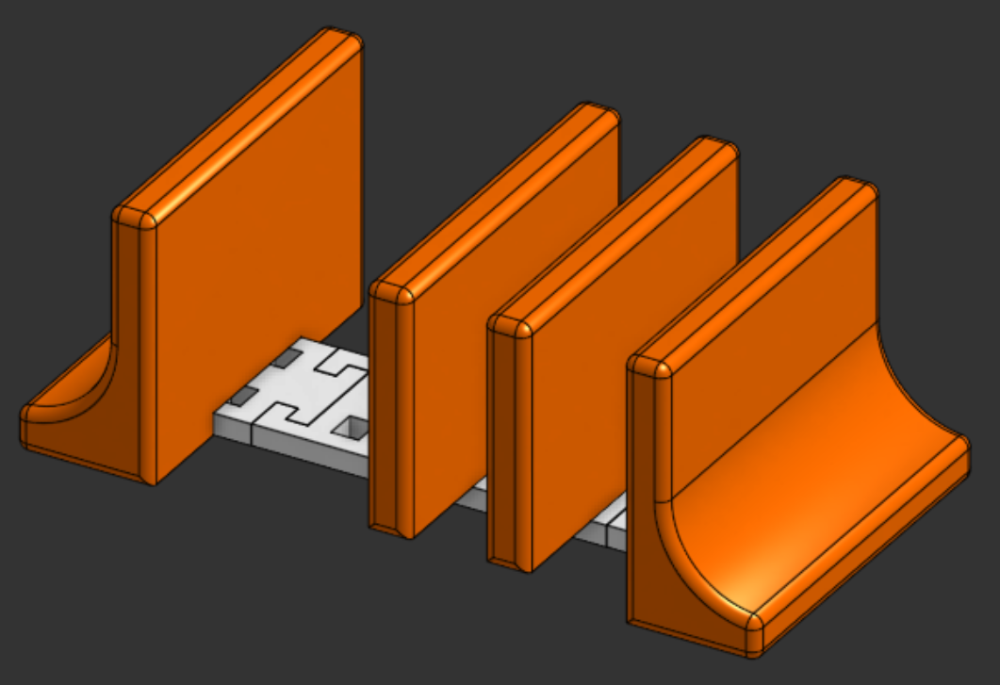

# hold-90
Hold 90 is a stand that lets you organize your stuff vertically.

## What is this?
Hold 90 is a stand that organizes your stuff, like a laptop, tablet, phone, book, etc vertically. It is extensible, so you can organize as much stuff as you want (you will just need to print extra connectors and mid-supports). It serves as a place for items of varying thickness. Easily extensible and collapsible. Designed from scratch in Onshape, this has a sleek and minimal vibe in orange and white colors, the same as my other previous projects.



## Repository Structure
```text
hold-90/
|
|---- Assets/-----------# Images and visual references for the project
|
|---- Hardware/---------# Source design files for the CAD
|
|---- LICENSE-----------# MIT License
|
|---- README.md---------# Project documentation and instructions
```

## Live 3d view in Onshape
Click [here](https://cad.onshape.com/documents/4ec9f21dc17d502f728c1132/w/7db6ad4b291b1342dc2aa1cb/e/9fab4c283862b14cce750cc5) to view Hold 90 in Onshape!

## How to get your own Hold 90?
1. Download the source CAD .step files from the [Hardware](Hardware/) directory
2. Import the file into your CAD editor and make edits as you want (Optional)
3. Go to your fabricater/ manufacturer website, get a quote, and purchase it (For Example, [ROBU](https://robu.in) or [JLCPCB](https://jlcpcb.com))
4. That's it! Wait for it to arrive and hold 90 your stuff!

## Fabrication Specs
1. Printer- 0.2 mm Standard Quality
2. Material- PLA
3. Color- Orange & White
4. Infill- 50% for supports & 90% for connectors

## License
[MIT](LICENSE)- Use, modify, share as you like!

## Notes
- If ya'll like this project, make sure to see my other projects [Phone Stand](https://github.com/vd-sh/phone-stand), [Keeb Stand](https://github.com/vd-sh/keeb-stand), or [Headset Stand](https://github.com/vd-sh/headset-stand)
- Or simply visit my [profile](https://github.com/vd-sh) to see the latest projects :)
